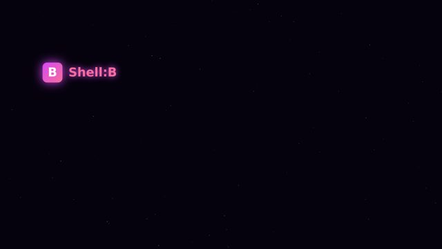
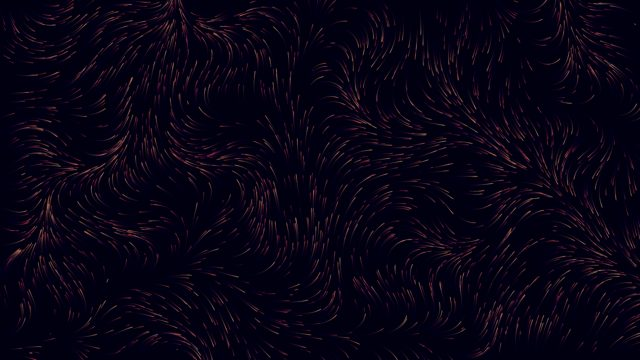
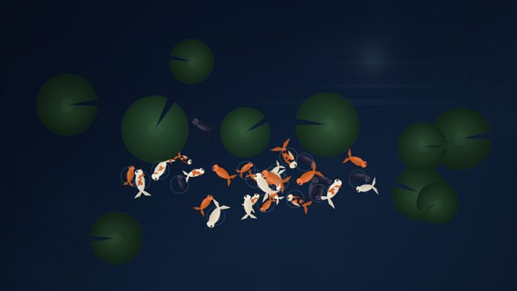
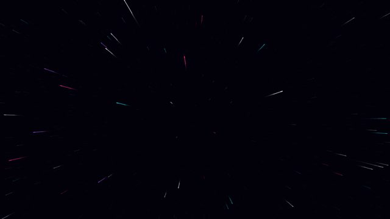
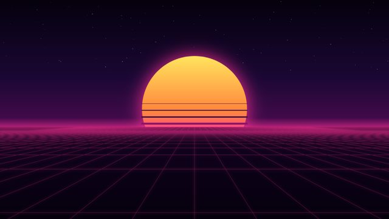

# Shell:B Screensavers

[](https://github.com/EveAeternam/Shell-B-Screensavers/actions/workflows/validate.yml) [](LICENSE)

Community screensavers for [Shell:B](https://github.com/EveAeternam/Shell-B), the local-first AI workspace.
Part of the family with [Shell-B-Themes](https://github.com/EveAeternam/Shell-B-Themes) and [Shell-B-Agents](https://github.com/EveAeternam/Shell-B-Agents).

A Shell:B screensaver is one `index.html` (plus whatever it needs in its folder) that animates forever with nobody
touching it. Shell:B shows it full screen in a sandboxed frame when the computer has been idle for a while, and any key
or mouse movement dismisses it. Screensavers run with scripts only: no same-origin access, no network, no audio.

## Install one

In Shell:B open **Settings → Appearance → Screensaver style** and press **Browse community**. Each screensaver here
appears with its preview; **Install** makes it a Screensaver project in your Studio (where you can open the code and
change it) and selects it as your screensaver. Shell:B fetches this repository as a tarball at a pinned commit, so the
list works offline once fetched.

## Catalogue

Click a preview to open the folder. The gallery below and `index.json` are generated by `scripts/validate.py`; don't
edit them by hand.

<!-- gallery:start -->
<table>
<tr>
<td align="center" valign="top" width="33%"><a href="screensavers/bouncing-logo"></a><br><b>Bouncing Logo</b><br><sub>by <a href="https://github.com/EveAeternam/Shell-B">Shell:B</a> · MIT</sub></td>
<td align="center" valign="top" width="33%"><a href="screensavers/harmonograph"></a><br><b>Harmonograph</b><br><sub>by <a href="https://github.com/EveAeternam/Shell-B">Shell:B</a> · MIT</sub></td>
<td align="center" valign="top" width="33%"><a href="screensavers/ink-currents"></a><br><b>Ink Currents</b><br><sub>by <a href="https://github.com/EveAeternam/Shell-B">Shell:B</a> · MIT</sub></td>
</tr>
<tr>
<td align="center" valign="top" width="33%"><a href="screensavers/koi-pond"></a><br><b>Koi Pond</b><br><sub>by <a href="https://github.com/EveAeternam/Shell-B">Evie &amp; Shell:B</a> · MIT</sub></td>
<td align="center" valign="top" width="33%"><a href="screensavers/starfield-warp"></a><br><b>Starfield Warp</b><br><sub>by <a href="https://github.com/EveAeternam/Shell-B">Shell:B</a> · MIT</sub></td>
<td align="center" valign="top" width="33%"><a href="screensavers/synthwave-horizon"></a><br><b>Synthwave Horizon</b><br><sub>by <a href="https://github.com/EveAeternam/Shell-B">Shell:B</a> · MIT</sub></td>
</tr>
</table>
<!-- gallery:end -->

## Make one

Start from [`template/index.html`](template/index.html): a full-window canvas, a clamped-`dt` loop, resize handling, a
reduced-motion slowdown and a pause while hidden. Replace `draw()`. Or let Shell:B build it: in Shell:B, **Settings →
Appearance → Make one in the Studio**, describe what you'd like, and export the project when you're happy with it.

Every screensaver is a folder under `screensavers/`:

```
screensavers/koi-pond/
  saver.json      name, blurb, author, license, version, tags, clockSafe
  index.html      the piece; relative paths only
  preview.jpg     a frame from the first seconds, about 640×360 (≤ 400 KB)
  assets/         optional: images, fonts, extra scripts
```

`saver.json`:

```json
{
  "name": "Koi Pond",
  "blurb": "One or two sentences for the picker (≤ 200 characters).",
  "author": "Your name",
  "authorUrl": "https://github.com/you",
  "license": "MIT",
  "version": "1.0",
  "tags": ["water", "calm"],
  "clockSafe": true,
  "credits": [{ "what": "Grain texture", "author": "Someone", "license": "CC0-1.0", "url": "https://…" }]
}
```

`author` is how you are credited: in Shell:B's picker, in the gallery above and in `index.json`; `authorUrl` links
it. `credits` names anything in the folder you didn't make yourself (a font, a texture, borrowed code) with its
license, which must allow redistribution.

`clockSafe` says the lower-left corner (about 30 % wide, 25 % tall) stays calm, because Shell:B may draw its clock
there. Set it to `false` if your piece uses the whole screen; the clock still shows, it just competes.

### The rules

They are the same ones Shell:B gives its own agents when they build a screensaver:

- It fills any aspect ratio: handle `resize`, no letterboxing, from 4:3 to ultrawide and portrait.
- Canvas 2D, SVG or CSS. Prefer Canvas 2D; there is no WebGL in the browser that takes the previews.
- A `requestAnimationFrame` loop with `dt` clamped, `devicePixelRatio` capped at 2, and no growth in memory or object
  count over hours: reuse particle pools, never append DOM nodes in the loop. Pause while `document.hidden`.
- Calm on the GPU. It must look good dark, since it often runs at night.
- Nothing static and bright, because it may run for hours on an OLED: drift every element slowly. Vary over minutes
  (seasons, palette shifts, new formations) so it never feels looped.
- No audio, no network, no external URLs: bundle every file in the folder. No controls, chrome, hover states or cursor.
- Respect `prefers-reduced-motion` by slowing to a gentle drift, not stopping.
- The first frame must already be a strong composition: previews capture the first second. Pre-roll a few frames if
  the piece needs to settle.
- Keep tuning constants (speeds, counts, palette) together at the top of the script.

Then check it and make the preview:

```bash
python3 -I scripts/validate.py          # rules above, sizes, index.json
scripts/preview.sh screensavers/<id>     # headless Firefox screenshot → preview.jpg
```

See [CONTRIBUTING.md](CONTRIBUTING.md) for the pull request checklist.

## Credit

Every screensaver names its author, linked when `authorUrl` is given, in Shell:B, in the gallery above and in
`index.json`; the git history keeps the pull request under your account. Third-party work goes in `credits`.

## License

The scripts and this repository are MIT. Each screensaver names its own license in `saver.json`; the ones here are MIT.

## Other collections

Shell:B installs from the whole family: [Shell-B-Themes](https://github.com/EveAeternam/Shell-B-Themes) and [Shell-B-Agents](https://github.com/EveAeternam/Shell-B-Agents) work the same way, with a validator, CI and a one-screen checklist each. Found a bug in the app itself? That goes to [Shell-B issues](https://github.com/EveAeternam/Shell-B/issues); questions and show-and-tell to [Discussions](https://github.com/EveAeternam/Shell-B/discussions).
